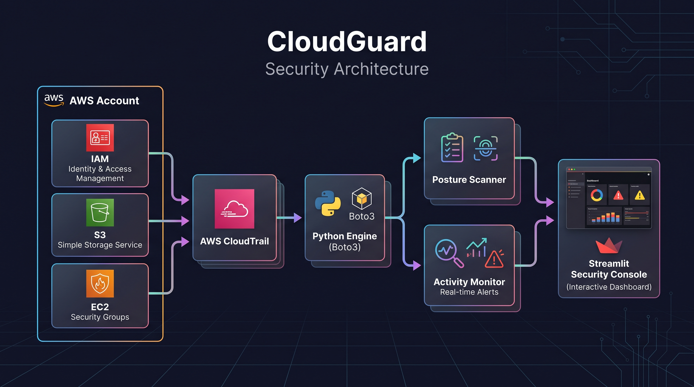
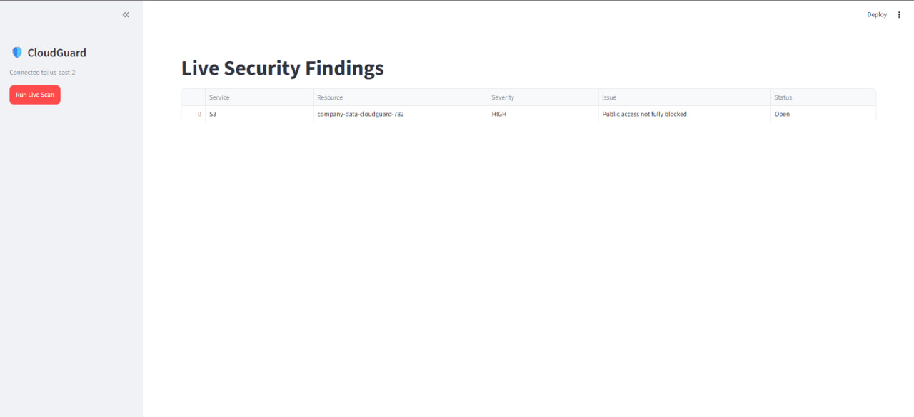
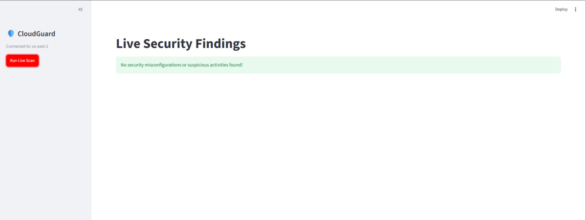

# CloudGuard: AWS Security Posture & Activity Monitoring Platform

CloudGuard is a lightweight Cloud Security Posture Management (CSPM) and threat detection tool designed to identify misconfigurations across core AWS services and monitor suspicious management activity using AWS CloudTrail.

## Architecture



## Key Capabilities

1. **Posture Assessment (CSPM Engine)**
   - **S3 Storage:** Scans buckets for missing public access blocks, disabled server-side encryption, and versioning protection.
   - **Network Exposure:** Identifies security groups allowing open inbound traffic (`0.0.0.0/0`) on sensitive administrative ports (SSH 22, RDP 3389).

2. **Runtime Activity Detection**
   - **Defense Evasion:** Identifies attempts to disable or alter audit trails (`StopLogging`, `DeleteTrail`).
   - **Identity Persistence:** Detects privileged IAM identity and credential generation (`CreateUser`, `CreateAccessKey`).
   - **Network Tampering:** Flags real-time firewall ingress modifications (`AuthorizeSecurityGroupIngress`).

## Risk Model

| Severity | Definition | Example Findings |
|---|---|---|
| **CRITICAL** | Direct exposure or audit blinding | Trail logging disabled, public bucket containing sensitive assets |
| **HIGH** | Significant attack surface expansion | Unrestricted ingress on administrative ports, IAM persistence actions |
| **MEDIUM** | Missing baseline security controls | Bucket default encryption disabled, console login without MFA |
| **LOW** | Operational hygiene risks | Bucket versioning disabled |

## Live Detection & Remediation Verification

CloudGuard was validated using controlled security scenarios to verify end-to-end detection and resolution tracking.

### 1. Misconfiguration Detected (Vulnerable State)
When an S3 bucket (`company-data-cloudguard-782`) has its Block Public Access settings disabled, the scanner immediately identifies the exposure and flags it with `HIGH` severity:



### 2. Post-Remediation Verification (Compliant State)
Once Block Public Access is re-enabled across all settings, the live scan re-evaluates the environment and verifies all resources conform to baseline security controls:



## Installation & Setup

1. Clone the repository:
   ```bash
   git clone [https://github.com/Irfan-Aiman/cloudguard.git](https://github.com/Irfan-Aiman/cloudguard.git)
   cd cloudguard